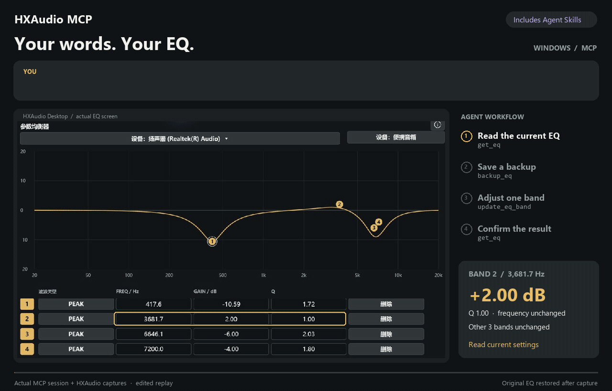

# HXAudio MCP

[](skills/)

[简体中文](README.zh-CN.md) · [Architecture](docs/ARCHITECTURE.md) · [License](LICENSE)

**Control HXAudio APO directly from an AI agent.** HXAudio MCP is a local [Model Context Protocol (MCP)](https://modelcontextprotocol.io/) server for reading and adjusting Windows HXAudio parametric EQ, preamp, and virtual bass settings—without automating the graphical interface.

The server communicates over **stdio** and applies supported changes through the Windows registry with HXAudio's live-reload notification mechanism.

## See it in action

> “Set the 3.7 kHz band to 0 dB. Keep everything else.”



An edited replay of actual MCP calls and HXAudio captures: read the EQ, save a backup, change one band, and verify the result. The original EQ was restored after capture.

**Includes Agent Skills** — browse [`skills/`](skills/) or open the [HXAudio EQ skill](skills/hxaudio-eq/SKILL.md) for the ready-to-use adjustment workflow. Configure the MCP server below, then make the skill available to your Agent client.

## Features

- **Parametric EQ:** list, replace, add, update, and remove filters for individual audio devices.
- **Audio controls:** adjust preamp and virtual bass; inspect other available DSP settings.
- **Live updates:** apply changes and inspect APO runtime status.
- **Preset management:** back up and restore DSP settings; inspect and import PEQ curves from `.hxconfig` files.
- **Agent-friendly:** structured MCP tools, an optional [EQ workflow skill](skills/hxaudio-eq/SKILL.md), and read-only mode.

## Requirements

- Windows 10 or 11 with **HXAudio APO** installed and configured.
- Python **3.11+**.
- An MCP-compatible client running on the **same Windows computer**.
- Permission to modify HXAudio registry settings. APO mode typically requires administrator privileges for system-level writes.

## Installation

Open PowerShell in the repository directory:

```powershell
python -m venv .venv
.\.venv\Scripts\Activate.ps1
python -m pip install -e .
```

Confirm that HXAudio is detected:

```powershell
hxaudio-mcp doctor
hxaudio-mcp devices
hxaudio-mcp eq
```

> **Note:** `hxaudio-mcp serve` starts a stdio server and is intended to be launched by your MCP client; it does not open a web page or interactive shell.

## MCP client configuration

Use the **absolute path** to the executable in your virtual environment. Replace the sample path with your own installation directory.

### Codex

Add the following to `~/.codex/config.toml`:

```toml
[mcp_servers.hxaudio]
command = 'C:\path\to\hxaudio-mcp\.venv\Scripts\hxaudio-mcp.exe'
args = ['serve']
startup_timeout_sec = 20
tool_timeout_sec = 30
```

Alternatively, register it using the Codex CLI:

```powershell
codex mcp add hxaudio -- "C:\path\to\hxaudio-mcp\.venv\Scripts\hxaudio-mcp.exe" serve
```

### Clients using `mcpServers` JSON

For clients that accept the `mcpServers` configuration format:

```json
{
  "mcpServers": {
    "hxaudio": {
      "command": "C:\\path\\to\\hxaudio-mcp\\.venv\\Scripts\\hxaudio-mcp.exe",
      "args": ["serve"]
    }
  }
}
```

The client launches the server locally. For APO write operations, the server process must have the required Windows registry permissions; these are inherited from the MCP client process.

## Available tools

| Tool | Description |
| --- | --- |
| `doctor` | Inspect installation mode, available profiles, and runtime status. |
| `list_audio_devices` | Discover audio devices and their `profile_key` identifiers. |
| `get_eq` | Read a device's PEQ filters. |
| `set_eq` | Replace the complete PEQ filter list. |
| `add_eq_band` | Append or insert a filter. |
| `update_eq_band` | Change selected properties of an existing filter. |
| `remove_eq_band` | Delete one filter. |
| `clear_eq` | Remove all filters for a device. |
| `get_preamp` / `set_preamp` | Read or adjust preamp gain. |
| `get_virtual_bass` / `set_virtual_bass` | Read or adjust virtual bass settings. |
| `inspect_dsp_settings` | Inspect additional DSP registry values (read-only). |
| `apply_eq` | Request a DSP configuration reload. |
| `get_runtime_status` | Read APO reload and runtime diagnostics. |
| `wait_for_apo_apply` | Check whether an APO generation has been observed. |
| `backup_eq` | Create a local DSP settings backup. |
| `restore_eq_backup` | Restore a backup by ID (requires `confirm=true`). |
| `inspect_hxconfig` | Read PEQ curves from an HXCF v1 `.hxconfig` file. |
| `import_eq_from_hxconfig` | Import a PEQ curve from an HXCF v1 export. |

### PEQ filter format

Filters use five fields:

```json
{
  "enabled": true,
  "type": "PK",
  "frequency_hz": 1000,
  "gain_db": -2.5,
  "q": 1.0
}
```

Supported types: `PK` (peak), `LS` (low shelf), `HS` (high shelf), `LP` (low pass), `HP` (high pass), and `NO` (notch). Band indices are **zero-based**.

`set_eq` replaces the entire list. Use `update_eq_band` to change one filter while keeping the others. When multiple devices are available, pass the exact `profile_key` obtained from `list_audio_devices`.

## Example agent requests

> Show the EQ settings for my speakers and create a backup.

> Set the first PEQ filter's gain to −2 dB, leaving its frequency and Q unchanged.

> Add a peak filter at 250 Hz with a gain of −1.5 dB and Q of 1.2, then show the updated curve.

> Import the PEQ curve from `C:\Users\me\Music\preset.hxconfig` into my selected output device.

## Configuration and usage notes

- **Read-only mode:** set `HXAUDIO_MCP_READ_ONLY=1` in the MCP client's environment to disable write operations.
- **Backups:** stored under `%LOCALAPPDATA%\HXAudioMCP\backups`; `restore_eq_backup` requires the returned backup ID and `confirm=true`.
- **HXAudio GUI:** the EQ editor can remain open while the MCP server applies changes. Avoid saving an older GUI state over newer MCP changes (or vice versa).
- **Audio headroom:** positive EQ gains can increase output level; adjust preamp as appropriate.
- **Local operation:** the stdio server does not expose an HTTP endpoint. It works with settings on the computer where it runs.

For the registry integration and project structure, see [Architecture](docs/ARCHITECTURE.md).

## License

[MIT](LICENSE). HXAudio MCP is an independent integration project and is not affiliated with the HXAudio developer. HXAudio itself is not included in this repository.

## Acoustic measurements

Install with `python -m pip install -e ".[calibration]"` and restart the MCP
server. Use `calibration_check` to identify the HXAudio profile and audio
endpoints. Use `calibration_measure` for individual captures and
`calibration_optimize` to preview a shared EQ fitted to both channels.
Use `calibration_compare_tones` to verify changes at selected frequencies.
For closed-loop calibration, start `calibration_run` and poll
`calibration_status`. A trial with `keep=false` restores the starting profile.

See [Acoustic calibration](docs/CALIBRATION.md) for routing, tool arguments,
stepped-sine verification and CLI sweep diagnostics.
